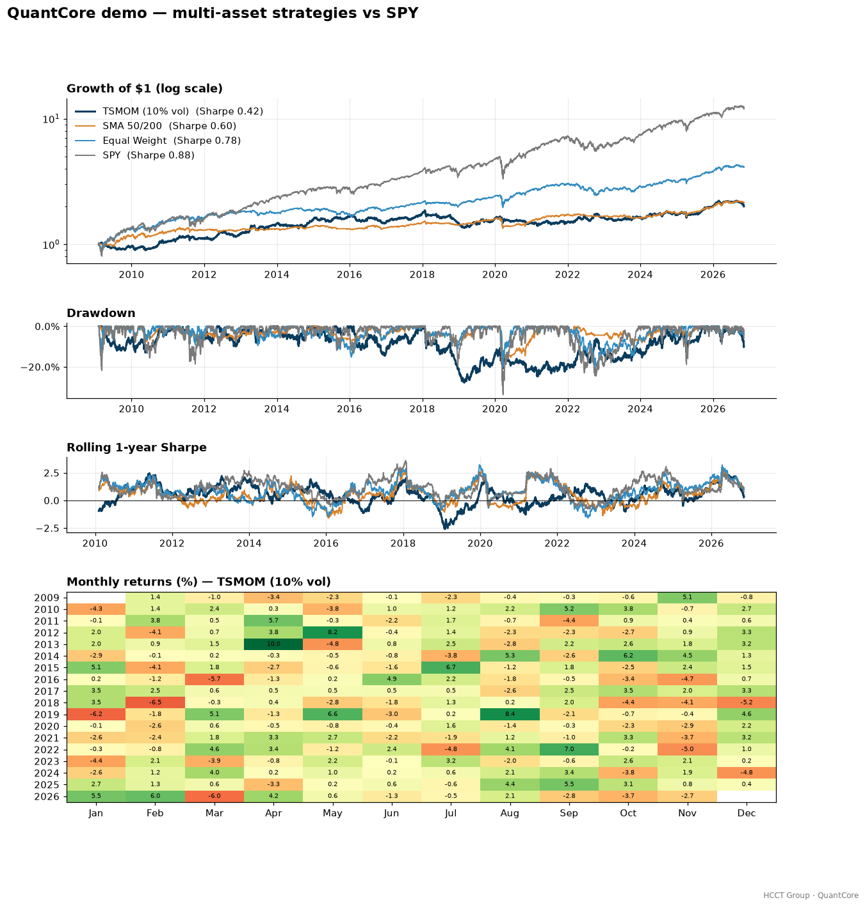
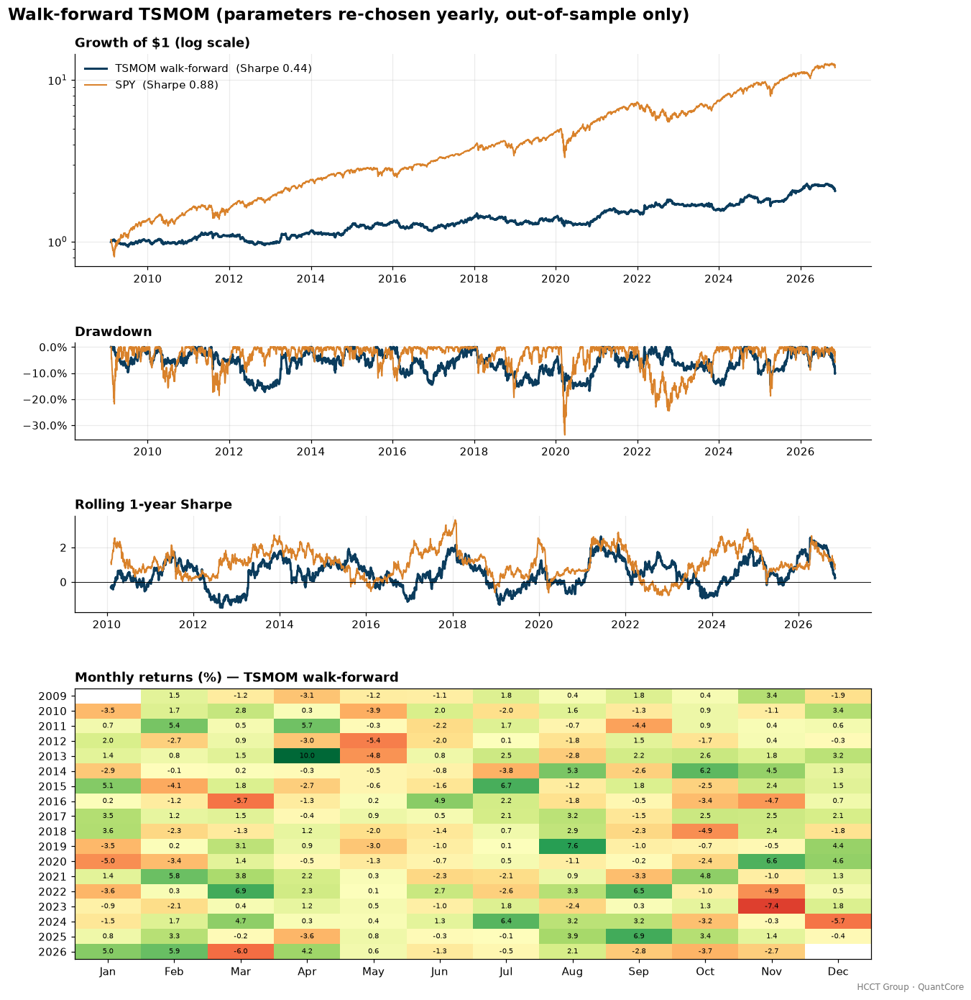

# HCCT Group – QuantCore

**A research-grade, vectorized backtesting engine in Python.**
Created by **Harry CHU** · HCCT Group

[](https://github.com/hcctbusiness/QuantCore/actions/workflows/ci.yml)


QuantCore is the shared engine behind the HCCT Group quantitative research series. It turns a matrix of target portfolio weights into a realistic, cost-aware performance record, and enforces the discipline that separates research from curve-fitting: execution lag, transaction costs, and walk-forward (out-of-sample) parameter selection.



## Why it exists

Most backtests on GitHub quietly look into the future, ignore trading costs, or report the single best parameter set found in hindsight. QuantCore is built to make those mistakes hard:

| Pitfall | How QuantCore handles it |
|---|---|
| Look-ahead bias | Signals decided at close *t* earn returns from *t+1* (`lag=1` default); covered by a unit test that proves a same-day signal only "works" with `lag=0`. |
| Free trading | Linear cost model (commission + slippage in bps, optional short-borrow fee) charged on turnover measured against the **drifted** book. |
| Hindsight optimisation | `walk_forward()` re-selects parameters on a rolling training window and trades them only on the following unseen window. |
| Uncontrolled risk | Volatility targeting using trailing realised vol only, with a leverage cap. |

## Features

- **Backtester** – `backtest(weights, prices, costs, lag)` → net/gross returns, held weights, turnover, cost drag.
- **Metrics** – CAGR, volatility, Sharpe, Sortino, max drawdown, Calmar, hit rate, skew, historical VaR/CVaR, beta/alpha, rolling Sharpe.
- **Sizing** – equal weight, inverse volatility, volatility targeting, calendar rebalancing.
- **Walk-forward** – rolling or anchored folds, parameter grids, out-of-sample stitching, parameter log.
- **Reference strategies** – buy-and-hold, SMA crossover, time-series momentum (Moskowitz–Ooi–Pedersen), cross-sectional momentum (12-1).
- **Reporting** – publication-ready tearsheet PNG (equity, drawdown, rolling Sharpe, monthly heatmap) and Markdown stats tables.
- **Data** – Yahoo Finance prices and FRED macro series (no API key) with a local cache.

## Results on real data

Multi-asset ETF universe (SPY, EFA, EEM, TLT, IEF, GLD, DBC, VNQ), daily data, 1 bp commission + 2 bp slippage. Out-of-sample period 2009-02 to 2026-11. Full output in [`docs/results.md`](docs/results.md).

| Metric | TSMOM walk-forward | TSMOM (10% vol) | SMA 50/200 | Equal Weight | SPY |
|---|---:|---:|---:|---:|---:|
| CAGR | 4.15% | 4.00% | 4.37% | 8.29% | 15.02% |
| Ann. Vol | 10.63% | 10.57% | 7.69% | 10.95% | 17.58% |
| Sharpe | 0.44 | 0.42 | 0.60 | 0.78 | 0.88 |
| Max Drawdown | -17.26% | -27.81% | -17.85% | -20.45% | -33.72% |
| Annual Cost Drag | 0.42% | 0.34% | 0.07% | 0.05% | 0.00% |

**Reading the results honestly:** simple trend rules on this ETF universe have not beaten US equities since 2009, a period dominated by one of the strongest equity bull markets on record. The walk-forward run improves on the static TSMOM drawdown (-17% vs -28%) but not on return. QuantCore exists to surface exactly this kind of finding before capital is committed. Strategy research lives in the companion repositories below.



## Quick start

```bash
git clone https://github.com/hcctbusiness/QuantCore.git
cd QuantCore
pip install -e ".[dev]"
pytest -q                 # 8 tests
python examples/demo.py   # regenerates docs/
```

Use it in your own project:

```bash
pip install "quantcore[data] @ git+https://github.com/hcctbusiness/QuantCore.git"
```

```python
import quantcore as qc

px = qc.data.prices(["SPY", "TLT", "GLD"], start="2010-01-01")
w = qc.strategies.time_series_momentum(px, lookback=252)
w = qc.sizing.vol_target(w, px, target=0.10)
res = qc.backtest(w, px, qc.CostModel(commission_bps=1, slippage_bps=2), name="TSMOM")

print(res.stats())
qc.report.tearsheet(res.returns, "tearsheet.png")
```

## Project structure

```
src/quantcore/
  backtest.py     # engine + cost model
  metrics.py      # performance & risk statistics
  sizing.py       # weighting, vol targeting, rebalancing
  walkforward.py  # rolling out-of-sample optimisation
  strategies.py   # reference strategies
  report.py       # tearsheets & markdown tables
  data.py         # Yahoo Finance / FRED loaders with cache
examples/demo.py  # reproduces every chart and table in this README
tests/            # unit tests (look-ahead, costs, vol target, walk-forward)
```

## HCCT Group quant research series

| Project | Focus |
|---|---|
| **QuantCore** | Backtesting engine (this repo) |
| [Macro-AI-Copilot](https://github.com/hcctbusiness/Macro-AI-Copilot) | Macro regime detection → multi-asset allocation |
| [Equity Factor Model](https://github.com/hcctbusiness/Equity-Factor-Model) | Cross-sectional factors, long/short, IC analysis |
| [HK Stat-Arb](https://github.com/hcctbusiness/HK-Stat-Arb) | Cointegration pairs and A/H-share premium |
| [Multi-Asset Trend Following](https://github.com/hcctbusiness/Multi-Asset-Trend-Following) | Futures-style CTA with vol targeting |
| ML Alpha Lab | Purged CV, meta-labelling, gradient boosting |
| Portfolio & Risk Engine | HRP, risk parity, Black-Litterman, VaR |

## Disclaimer

For research and education only. Not investment advice. Past performance does not guarantee future results.

---
© 2026 Harry CHU · HCCT Group · MIT License
